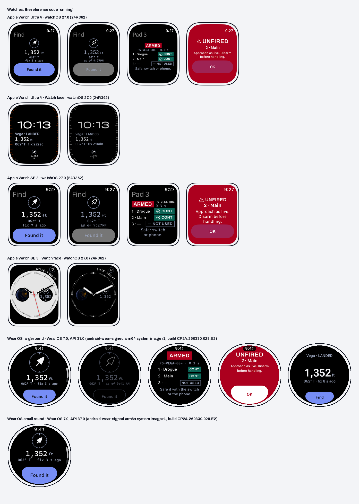

# Real screens

Screenshots of the reference code running in the sample apps on simulators and emulators, captured 2026-11-09. The drawn
mock-ups next to this folder show the intent; these show what the code actually does. Built by `tools/build/kit_devices.py`
from `source/product/devices/`, where `devices.json` records each capture's device, OS, size and what it shows.

| File | Device | Shows |
|---|---|---|
| `watch-se40-find-aod.png` | Apple Watch SE 3, watchOS 27.0 (24R362) | FSWatchFind with isLuminanceReduced forced true (Always On), for the capture |
| `watch-se40-find.png` | Apple Watch SE 3, watchOS 27.0 (24R362) | FSWatchFind |
| `watch-se40-pad.png` | Apple Watch SE 3, watchOS 27.0 (24R362) | FSWatchState, ARMED |
| `watch-se40-unfired.png` | Apple Watch SE 3, watchOS 27.0 (24R362) | FSWatchUnfired |
| `watch-ultra-find-aod.png` | Apple Watch Ultra 4, watchOS 27.0 (24R362) | FSWatchFind with isLuminanceReduced forced true (Always On), for the capture |
| `watch-ultra-find.png` | Apple Watch Ultra 4, watchOS 27.0 (24R362) | FSWatchFind |
| `watch-ultra-pad.png` | Apple Watch Ultra 4, watchOS 27.0 (24R362) | FSWatchState, ARMED |
| `watch-ultra-unfired.png` | Apple Watch Ultra 4, watchOS 27.0 (24R362) | FSWatchUnfired |
| `watch-ultra-face.png` | Apple Watch Ultra 4, watchOS 27.0 (24R362) | Modular Ultra with Find the rocket in the middle (rectangular) and bottom-middle (circular) slots |
| `watch-ultra-face-aod.png` | Apple Watch Ultra 4, watchOS 27.0 (24R362) | The same face in Always On: the age to the minute |
| `watch-se40-face.png` | Apple Watch SE 3, watchOS 27.0 (24R362) | Infograph with Find the rocket in the top-right corner and the right sub-dial, at 10:10; the fix is past its 60 s limit, so the corner says STALE and the arrow is outlined |
| `watch-se40-face-aod.png` | Apple Watch SE 3, watchOS 27.0 (24R362) | The same face in Always On |
| `wear-find.png` | Wear OS large round, Wear OS 7.0, API 37.0 (android-wear-signed arm64 system image r1, build CP2A.260330.028.E2) | Find |
| `wear-pad.png` | Wear OS large round, Wear OS 7.0, API 37.0 (android-wear-signed arm64 system image r1, build CP2A.260330.028.E2) | Pad, read only |
| `wear-unfired.png` | Wear OS large round, Wear OS 7.0, API 37.0 (android-wear-signed arm64 system image r1, build CP2A.260330.028.E2) | Unfired |
| `wear-find-ambient.png` | Wear OS large round, Wear OS 7.0, API 37.0 (android-wear-signed arm64 system image r1, build CP2A.260330.028.E2) | Find in ambient mode (KEYCODE_SLEEP) |
| `wear-tile-find.png` | Wear OS large round, Wear OS 7.0, API 37.0 (android-wear-signed arm64 system image r1, build CP2A.260330.028.E2) | Find tile |
| `wear-small-find.png` | Wear OS small round, Wear OS 7.0, API 37.0 (android-wear-signed arm64 system image r1, build CP2A.260330.028.E2) | Find at the small size class |

The screens were also captured at the largest text size each platform offers (Accessibility 5 on iPhone, font scale 2.0
on Android, Accessibility 3 and 1 on the 49 mm and 40 mm watches, 1.24 on Wear OS). There they scroll, so those captures,
caught part way through, aren't shown here; they're in `source/product/devices/`, and the build reads them back with text
recognition and stops on any line cut short with "…".

The sample apps are in `source/product/samples/` (their READMEs list what running them found and fixed).
