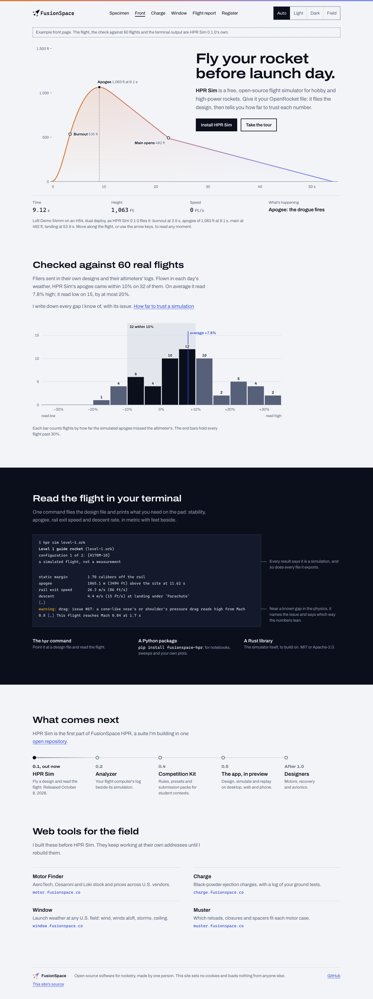
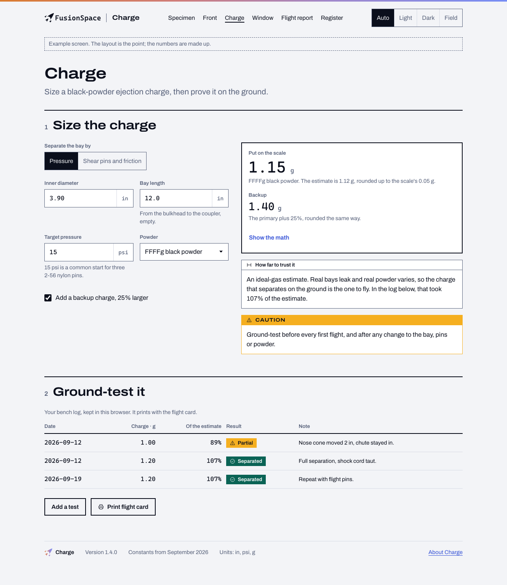
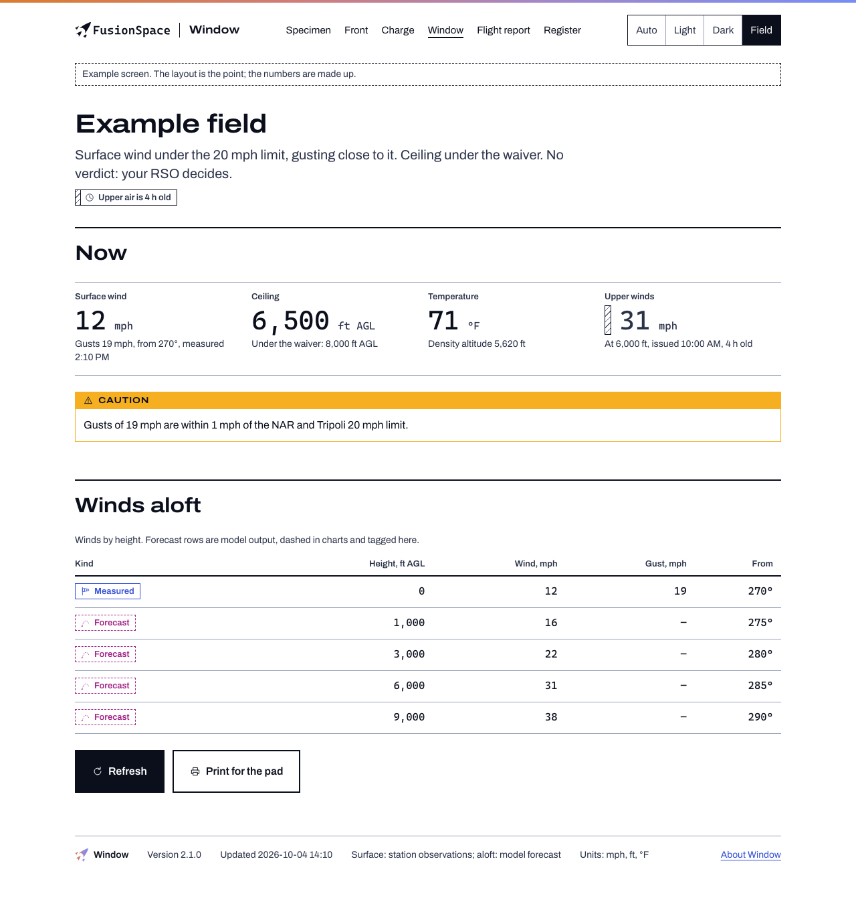
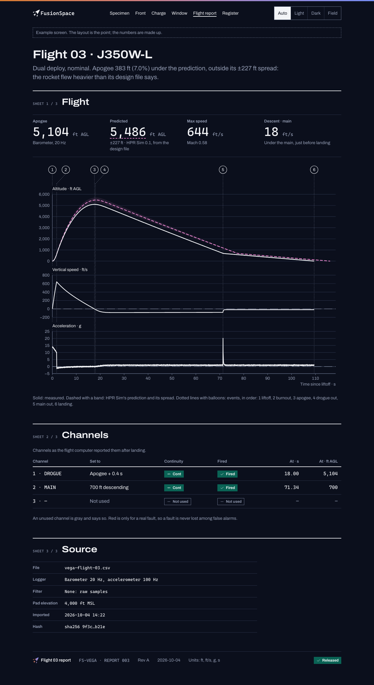

# Web

Websites, in-browser tools, progressive web apps and documentation sites. The reference implementation is
[`web/fusionspace.css`](web/fusionspace.css), with a specimen ([`web/index.html`](web/index.html)) and five example pages
in [`web/examples/`](web/examples/). Open them in a browser and switch between Light, Dark and Field. A page is built at one
of three levels, front, tool or record ([`principles.md`](principles.md#three-levels)), and each level has its own anatomy
below.

| | |
|---|---|
|  |  |
|  |  |

## Using it in a project

1. Copy `product/web/fusionspace.css`, `fonts.css` and `fonts/` into the project (or `tailwind-theme.css` too, for Tailwind).
2. Load `fonts.css`, then `fusionspace.css`. Preload at most the two fonts used above the fold:
   `<link rel="preload" href="fonts/CascadiaMono-SemiBold.woff2" as="font" type="font/woff2" crossorigin>`.
3. Set `<meta name="color-scheme" content="light dark">` and the two `theme-color` metas (Paper and Void) from
   `kit/web/head.html`.
4. Set the page's level on `<html>`: `data-level="front"` or `data-level="tool"`; a record needs none. The attribute
   also works on any element, for a panel at another level.
5. Build pages from the parts below. Use the `--fs-*` roles for anything custom; never a hex value, never a default palette.
6. Copy the icons you need from `product/icons/` as inline SVG (they use `currentColor`).

With **Tailwind**, import `tailwind-theme.css` instead of Tailwind's default theme. It maps the roles to utilities
(`bg-canvas`, `text-ink-muted`, `border-rule-strong`, `font-mono`) and removes the default palette, radii and shadows, so the
template look (indigo buttons, `rounded-xl`, `shadow-lg`) can't creep in.

## Page anatomy

Every level opens with the gradient strip and a header, and every level has the theme switch.

- **Header.** The horizontal lockup at 24 px tall, in one color: Void on light and field, Paper on dark. The gradient lives
  in the strip (principle 6), and the brand's rule for small lockups on light is met in every theme. Navigation links
  in Archivo, or in Cascadia Mono on a record; the current page underlined 2 px. No hamburger above 720 px. A tool puts its
  name beside the lockup, after a 1 px rule.
- **Theme switch.** Auto, Light, Dark and Field, on every page.

**A front page** leads with the product's own work and shapes each section from what it holds:

```
[ gradient strip, 4 px ]
[ header: lockup · navigation · theme switch ]
[ the product's own output, with the headline, one or two sentences and two buttons beside or over it ]
[ a section for each thing worth showing, each in the form its content has ]
[ plain footer: the mark, one sentence, links ]
```

- **The opening.** The headline says what the product does for the reader. Under it, a sentence or two say what it is,
  and two buttons follow: ink primary, outlined secondary. The figure beside or under them is real output, never an
  illustration. No designation tag, status chip or label above the headline.
- **Sections.** Each takes the form of what it holds: a chart, a terminal, a timeline, an index. Its heading is a plain
  statement, with no label above it. Sections are parted by space; a full-width band in a different surface marks the
  one that changes medium, such as a terminal.

**A tool** is a few parts, inputs beside the result:

```
[ gradient strip, 4 px ]
[ header: lockup | tool name · navigation · theme switch ]
[ title · one-sentence lead ]
[ 1  Part name | content ]          2 px ink rule on top of each part; numbered only when the parts are steps
[ 2  Part name | content ]
[ one-line footer: tool and version · data and its date · units · About ]
```

**A record** is a sheet from a drawing set:

```
[ gradient strip, 4 px ]
[ header: lockup · navigation (Cascadia Mono 14) · theme switch ]
[ intro: designation tag · status chip · title · one-sentence lead ]
[ SHEET 1 / n · name | content ]      2 px ink rule on top of each sheet
[ SHEET 2 / n · name | content ]
[ title block: owner · title · designation · rev · date · units · data · status ]
```

- **Search.** On a docs site, the search field its button opens stands under the header, in the column: its edges on
  the text's, and 16 px between it and the intro, so its focus ring never touches the title.
- **Intro.** On a record: the designation tag (chamfered), a status chip, the title (Cascadia Mono 28) and one sentence in
  `lead`. On a tool: the title and the sentence. No hero image, no background art, no gradient text.
- **Sheets.** On a record, each section is a sheet with its number and name in the rail. Two to six sheets per page.
- **Page arrows.** On a page of a set read in order (docs), links to the previous and the next page end its text, above the
  footer and inside the column: the previous at the column's left edge, the next at its right, each a bordered button
  at least 44 px tall that names its page ("Previous" or "Next" in `label`, then the page's title). Never only an arrow at
  the window's side, where a reader on a wide window doesn't look.
- **Title block.** Every record ends with one. Fields from ISO 7200: owner (FusionSpace, with the mark), title, designation,
  revision or version, date of issue, units, data source and its date, status. A tool's about box holds the same fields.

## Site patterns

- **The home page is a front page.** It opens with the main product's own output, then shows what backs it up: a check
  against real data, the program's output, what comes next as a timeline, and the other tools as a plain index (name, one
  line, address). See [`examples/front.html`](web/examples/front.html), whose layout is its own (`front.css`,
  `front.js`) and not a shared part. A drawing register ([`examples/home.html`](web/examples/home.html)) is the record version, for a
  project's list of parts and releases.
- **A front page's figure** is drawn at the width it's shown, so its words stay 13 px from 320 to 1920 px instead of
  scaling with the window. If the reader can move along it, it's one control: a slider to a screen reader, with the
  arrow keys, Home and End, a value said in words ("9.1 seconds: 1,063 feet, 0 feet per second, apogee"), and a readout
  under the figure, never a tooltip that can run off an edge. Its focus shows on the figure's own marker and readout.
  When words sit over it, the page's check proves the line and its labels stay clear of them at every width.
- **A tool page** (Charge, Window) puts inputs left and the result right, the result sticky as the inputs scroll; on a phone
  the result follows the inputs. A choice that changes which inputs apply comes first. The result panel has a 2 px ink
  border, the headline readout, a "Show the math" disclosure, the "How far to trust it" note, and any caution. The
  headline readout is the number the reader acts on: the grams to put on the scale, rounded as the scale reads, with the
  estimate it came from under it.
- **An analysis page** (a flight report) leads with readouts, then the stacked chart, then the event and channel tables, then a Source
  sheet with the file, its hash and every setting used.
- **A board** (Window) is readouts plus a table, with every value's source and age, and a Print button.
- **Docs** are sheets of prose with a left table of contents; code blocks in Cascadia Mono on the surface color. The reader
  can put the table of contents away and bring it back at every width: a menu button in the header, or its edge dragged to
  the window's side. Put away, the page's column re-centers in the whole window. The choice is kept from page to page; a
  first visit shows it from 720 px.
- **First run.** No splash screen, no tour, no sign-up. A tool opens ready to use, with a worked example filled in and
  labeled as one ("Example: 4 in airframe, 12 in bay"), so the first thing anyone sees is a real result and how it was made.
- **Privacy.** No accounts, no ads, no third-party tracking or fonts. If a tool counts visits, it uses a cookieless,
  self-hosted counter and says so in the title block's notes. User data (logs, ground tests, designs) stays in the browser
  unless the user exports it.

## Components

All in `fusionspace.css`, shown in the specimen. The rules that matter:

- **Buttons.** Square, 44 px tall (with `data-size="field"`: 96 px on touch screens, 64 px with a mouse), sentence case:
  Archivo 15 semibold on front pages and tools, Cascadia Mono 14 semibold on a record. Primary is ink
  filled; hover turns it Ion. Secondary is a 2 px ink outline; quiet is an Ion text link. Danger is the Flare fill, and only
  for actions that fire, arm or destroy. Disabled is a dashed outline, and says why nearby.
- **Fields.** Label above (Archivo 13 semibold on a tool, Cascadia Mono 12 capitals on a record, muted), input 44 px
  tall with a 1 px Slate border, help below. Numbers go in
  `type="text" inputmode="decimal"` (GOV.UK's finding: `type="number"` loses leading zeros, accepts `e`, and changes on
  scroll), parsed as [`data.md`](data.md#copying-and-typing-numbers) says, with the unit fixed in a box on the right and the
  value as read shown back. Errors: 2 px danger border and a
  message under the field.
- **Segmented control** for a choice among two to four (units, theme, separation method); **tabs** for views of the same thing.
- **Status chips**: word + icon + color, see [`foundations.md`](foundations.md#color). **Notes**: NOTE, CAUTION, WARNING
  panels with the signal word in a header strip; "How far to trust it" uses the same shape.
- **Hazard border** (45° Sodium and Void bands) around anything that arms or fires; SAFE sits right of or below ARM.
- **Arming and firing** from a page take two separate actions: the button opens a confirmation, which is held for 2 s (or
  the channel's name is typed). They work only with the device's physical switch already on. SAFE is always one action.
- **Dialogs** have a 2 px ink border over a dimmed page, a title, the consequence in one sentence, and buttons that repeat the
  action. Use one only to confirm something irreversible.
- **Toasts** for "saved", "copied", "new version": bottom left, 2 px ink border, announced politely (`role="status"`). A toast
  with an action (Reload) stays until it is used or dismissed; the rest leave after 6 s. Never for errors.
- **Progress** is a 4 px bar in ink; indeterminate is a moving 45° hatch. Show progress for anything over a second; simulations
  run in a Web Worker so the page stays responsive.

## Theme

- Light by default, dark when the system asks (`prefers-color-scheme`), field on request. `<html data-theme="light|dark|field">`
  overrides the system; remember the choice in `localStorage` (wrapped in try/catch). A theme switch with Auto, Light, Dark and
  Field belongs on every page, at every level.
- Set `theme-color` to Paper and Void with media queries, as `kit/web/head.html` does; browsers differ in whether and where
  they show it, so nothing depends on it.
- `forced-colors` (Windows high contrast) is handled in the stylesheet: borders and outlines, never shadows, carry every
  boundary; icons are `currentColor`.

## Accessibility

WCAG 2.2 AA, with these as the ones that change the design:

- Contrast as in [`foundations.md`](foundations.md#contrast): measured by the build.
- Targets at least 24 × 24 px (2.5.8); 44 px for touch-first tools; for anything used at the pad, 96 px on touch
  screens and 64 px with a mouse.
- A visible focus ring on everything: 2 px Ion outline, 2 px offset (meets the 2.4.13 AAA appearance rule too). Sticky headers
  set `scroll-padding-top` so focus is never hidden (2.4.11).
- Works at 320 px wide without sideways scrolling, except data tables and charts in their own scrolling region (1.4.10).
- Text in rem, so the reader's font setting and zoom enlarge it (1.4.4); a reading page's scale grows with the window in rem
  plus vw, never vw alone.
- Status never by color alone; charts with a text summary and their data as a table.
- Live values: announce changes of state (`role="status"`, polite), never every new reading; only DANGER and WARNING states
  are announced assertively.
- `lang` set, landmarks (`header`, `main`, `nav`, `footer`), one `h1`, headings in order.
- Respect `prefers-reduced-motion`.

## Progressive web apps

Field tools should install and work offline. iOS 26 opens every home-screen site as a web app, so plan for it even without
an install prompt.

- **Manifest:** `name` FusionSpace tool name, `id`, `start_url`, `display: standalone`, `theme_color` and `background_color`
  set to the canvas the app opens in (Paper `#F3F4F7` for light-first field tools, Void `#0B0F1C` for dark-first ones), a `description`, wide and narrow `screenshots` (Chrome's richer install sheet), `shortcuts` for the main
  tasks, and the icons from `kit/web/` and `kit/web/site/public/`: separate `any` and `maskable` PNGs (192 and 512), a
  `monochrome` icon, an SVG, and the 180 px `apple-touch-icon`.
- **Offline:** precache the app shell; cache-first for versioned data (thrust curves, motor database, constants), with the
  version in the title block; network-first with a visible "as of" time for live data (stock, weather); logs and user data in
  IndexedDB, always exportable. Weather and map tiles are fetched before the trip with a "Save for offline" action.
- **Updates:** a toast saying "New version ready · Reload", never a forced reload in the middle of a task.
- **Storage:** installed web apps keep their storage (WebKit's 7-day eviction doesn't apply to them), but tell users to export
  anything they care about.
- **At the pad:** request a screen wake lock on countdown and tracking screens only, and release it when the screen is left.

## Notifications

Push notifications (installed web apps on iOS 16.4 and later, and everywhere else) only for something the user asked to be
told about, in their words: "Window: gusts at Example field now under 15 mph". Never for news, updates or anything to bring
people back. Each one says what changed, its value and unit, and its source time.

## Performance

- Core Web Vitals at the 75th percentile on mobile: LCP ≤ 2.5 s, INP ≤ 200 ms, CLS ≤ 0.1.
- WOFF2 subsets only (`product/web/fonts/`, Latin plus the technical symbols), `font-display: swap`, metric-matched fallbacks.
- No frameworks needed for a calculator. When one is used, server-render the first view.
- Heavy work (simulation, log parsing, Monte Carlo) in a Web Worker or WebAssembly.

## Print

Every tool page prints usefully: a charge card, a flight card, a weather sheet for the pad.

- Print uses the light values whatever the theme, hides navigation and theme controls, keeps sheets and table rows together,
  shows link addresses, and keeps the title block (with date and version) on the page.
- A dedicated "Print flight card" layout is better than printing the screen: A6 or half-letter, the designation, the motor,
  the charges, the settings, blank boxes to tick and sign.
- Page margin boxes (`@page` headers and footers) only work in Chrome 131 and later, so put the date and version in the body.

## Documentation sites

`kit/software/docs-theme/` has MkDocs Material and Docusaurus themes, and `product/web/mdbook/` an mdBook theme (hpr-sim's docs
use mdBook). The mdBook theme sets the colors, the fonts and the page's frame: the type scale on mdBook's elements, growing with
the window on the book's pages (a docs page is a reading page), and the column, centered beside the sidebar up to 1120 px
with the prose filling it, with mdBook's page arrows as bordered buttons under the text, inside the column, instead of over
its sides. mdBook's menu button and its sidebar's drag handle put the sidebar away; keep both. It also fixes mdBook's own defaults
where they break these rules, with scripts on or off: equations in the math face (`foundations.md`, *Type*), code in ink,
square corners and no shadows, the system's motion, selection and focus ring, borders where forced colors drop a fill, the
fonts' fallbacks, nothing cut off on a phone, and print in the light theme with link addresses. It sets each role as `--fs-<role>` on every mdBook theme, for a site's own
rules. mdBook's `rust` theme carries the field theme, so a docs site's switch offers Field with the rest. A docs site
is a tool: the theme sets its headings, labels and navigation at that level. Keep the writing rules from [`writing.md`](writing.md). Every docs page starts with what works and how far to trust it, as hpr-sim's does.

**Check a site with the system's own check.** `web/check/fusionspace-check.js` holds the numbers the rules set (the type
scale, the reading scale, the widths) and the code that measures them: it finds prose held narrower than the box that holds
it, and math wider than its box. This repository's build runs it on its own pages from 320 to 1920 px; a site built on the
system copies it into its page check and runs the same file, so a rule changed here reaches every check that copies it. Copy it with the
revision it came from.

## fusionspace.co

The live site (checked November 8, 2026) is built on this system at the record level: a designation tag over the
headline, four numbered sheets, and a title block. Its stylesheet is an older copy of `fusionspace.css`, with sizes in px.
The record level is right for a register of parts, but too much for a page that meets people first. To bring it in line:

1. Make the home page a front page (Site patterns, above). Open with HPR Sim's own flight: the altitude it flew, drawn in the
   gradient, which the reader can move along. Follow it with the check against 60 logged flights, the `hpr sim` output
   with its trust notes, what comes next as a timeline, and the older tools as a plain index.
2. Replace the title block with a plain footer, and drop the designation tags and sheet numbers from the page.
3. Update its stylesheet to this repository's `fusionspace.css` and fonts, with the Archivo variable font.
4. Keep the copy's substance, and edit it to [`writing.md`](writing.md): the landing page is one person talking, so it
   uses "I".
5. Leave the older tools' own pages as they are until they're rebuilt.
